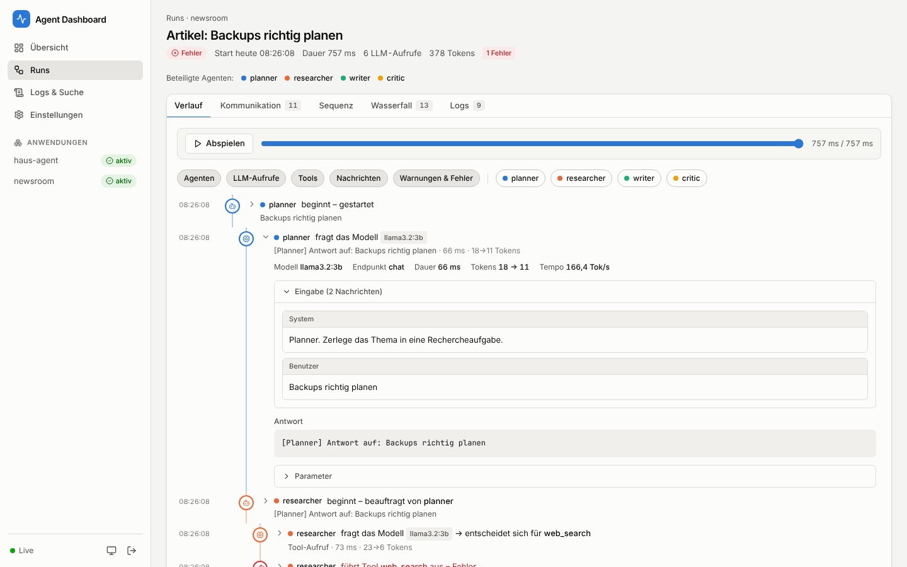
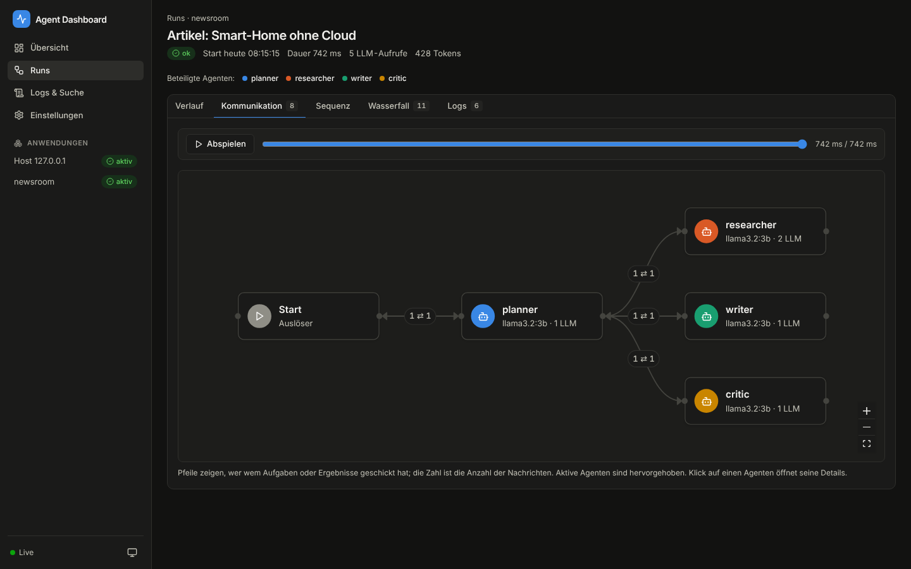
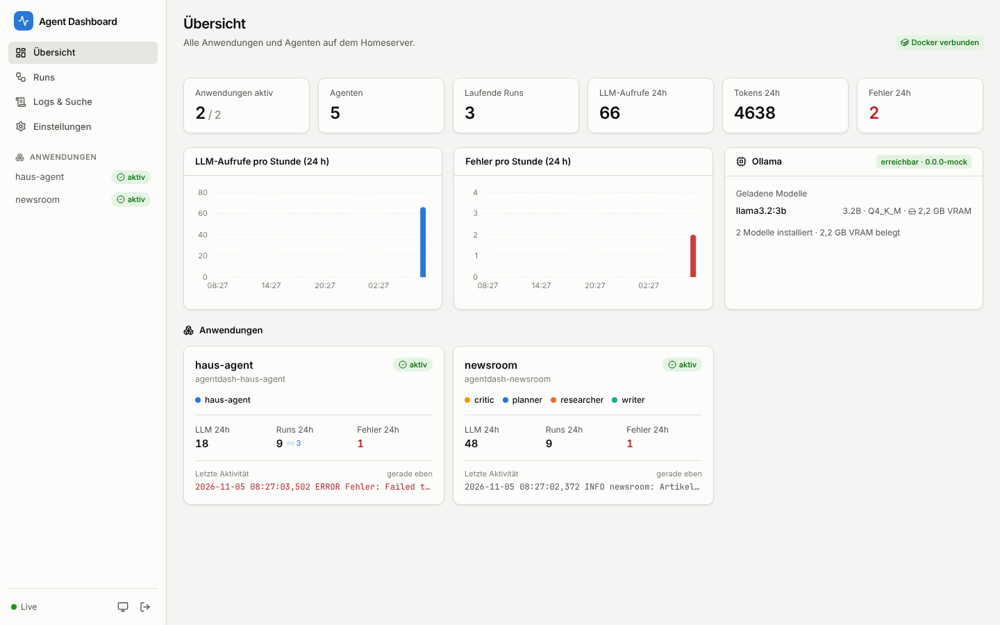
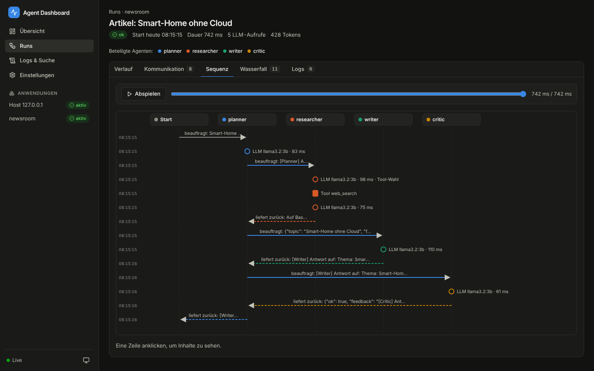
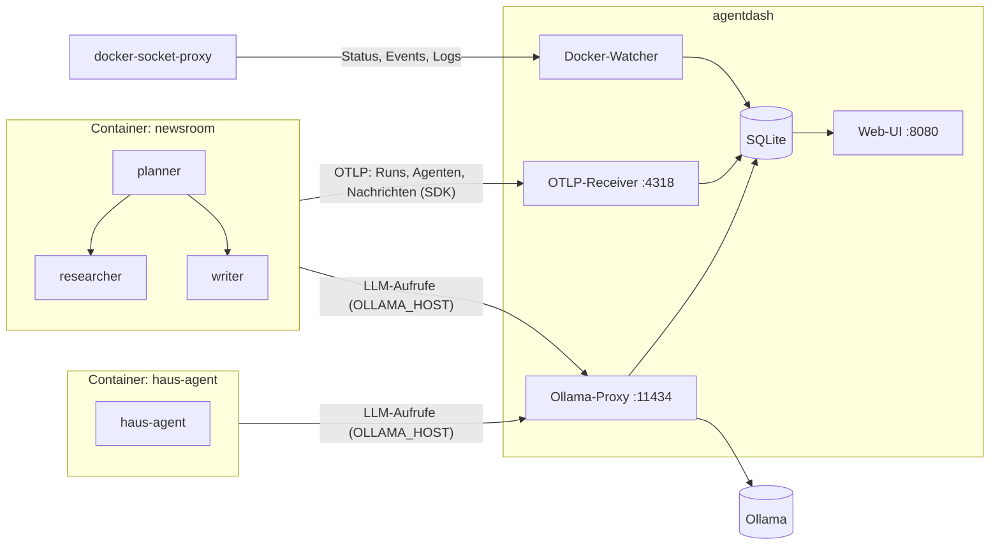

# Agent Dashboard

Ein selbst gehostetes Dashboard für den Homeserver, mit dem sich **nachvollziehen lässt, was lokale KI-Agenten tun**:

- **Alle Agenten im Blick:** jede Anwendung (= Docker-Container) mit ihren Agenten, Status, Modell und Aktivität
- **Logs live und durchsuchbar:** Container-Logs, SDK-Logs und LLM-Aufrufe in einer Ansicht, mit Volltextsuche
- **Jeder LLM-Aufruf:** Prompt, Antwort, Denkprozess (`thinking`), Tool-Entscheidungen samt Ergebnis, Tokens und Dauer
- **Kommunikation zwischen Agenten:** Kommunikationsgraph, Sequenzdiagramm, Wasserfall und ein lesbarer Verlauf pro Run, auch als Replay
- **Ollama-Status:** geladene Modelle und VRAM

| Verlauf eines Runs | Kommunikation zwischen Agenten |
|---|---|
|  |  |
|  |  |

Die Agenten laufen mit **Ollama** in **Docker-Containern**. Vieles funktioniert **ohne Codeänderung**. Für Multi-Agent-Anwendungen gibt es ein kleines Python-SDK.



---

## Schnellstart

```bash
git clone https://github.com/NdotC/agent_dashboard.git
cd agent_dashboard
docker compose -f deploy/docker-compose.yml up -d --build
```

Danach ist das Dashboard unter `http://<homeserver>:8080` erreichbar.

Standardmäßig erwartet es Ollama nativ auf dem Host (`http://host.docker.internal:11434`). Läuft Ollama selbst als Container, setze in einer `.env` neben der Compose-Datei:

```env
OLLAMA_UPSTREAM=http://ollama:11434   # Ollama-Container muss im Netz "agentdash" hängen
AGENTDASH_PASSWORD=ein-sicheres-passwort
```

### Demo ohne GPU

Ein Mock-Ollama, eine Multi-Agent-„Redaktion“ (planner → researcher → writer → critic) und ein einzelner Agent ohne SDK:

```bash
docker compose -f deploy/docker-compose.yml -f deploy/docker-compose.demo.yml up -d --build
```

Mit echtem Ollama den Dienst `mock-ollama` aus der Demo-Datei entfernen und `DEMO_MODEL` auf ein installiertes Modell setzen.

---

## Agenten anbinden

### Stufe 1: ohne Codeänderung

Im `docker-compose.yml` deines Agenten:

```yaml
services:
  mein-agent:
    image: mein-agent:latest
    labels:
      agentdash.enable: "true"          # Container im Dashboard anzeigen (Status + Logs)
      agentdash.app: "mein-agent"       # optional: Anzeigename der Anwendung
      agentdash.agent: "assistent"      # optional: Name des (einzigen) Agenten
    environment:
      OLLAMA_HOST: http://agentdash:11434   # LLM-Aufrufe laufen über das Dashboard
    networks: [agentdash]

networks:
  agentdash:
    external: true
```

Damit siehst du:

- **Container-Status und Logs**, live und durchsuchbar
- **jeden LLM-Aufruf** mit Prompt, Antwort, Denkprozess, Tokens und Dauer
- **Tool-Aufrufe:** Die Entscheidung des Modells stammt aus der Antwort. Das Ergebnis erkennt das Dashboard am nächsten Request desselben Gesprächs.
- **automatisch erkannte Runs:** zusammenhängende Gespräche werden gruppiert

Das Dashboard ordnet Aufrufe über die IP-Adresse dem Container zu. Container, die den Proxy nutzen, erscheinen auch ohne Label automatisch.

### Stufe 2: mehrere Agenten in einer Anwendung (SDK)

Laufen mehrere Agenten im selben Container, macht das SDK sichtbar, welcher Agent was tut und wer wen beauftragt:

```bash
pip install "git+https://github.com/NdotC/agent_dashboard.git#subdirectory=sdk/python"
```

```python
import agentdash
from agentdash import run, agent, tool, send_message

agentdash.init()  # Endpoint aus $AGENTDASH_ENDPOINT, Standard: http://agentdash:4318

@tool
def web_search(query: str) -> str:
    ...

@agent("researcher", role="Recherche")
def research(question: str) -> str:
    return web_search(question)          # LLM-Aufrufe hier werden "researcher" zugeordnet

with run("Artikel schreiben"):           # ein Run = ein Durchlauf
    with agent("planner") as planner:    # Start → planner
        facts = research("KI News")      # planner → researcher, Rückgabe researcher → planner
        send_message("writer", facts, kind="handoff")   # explizite Nachricht
        planner.set_output("fertig")
```

Umgebungsvariablen im Agent-Container:

```yaml
environment:
  OLLAMA_HOST: http://agentdash:11434
  AGENTDASH_ENDPOINT: http://agentdash:4318
```

| Funktion | Bedeutung |
|---|---|
| `run(title)` | Ein Durchlauf (z. B. eine Benutzeranfrage). Kontextmanager oder Dekorator, sync und async. |
| `agent(name, input=None, role=None)` | Ein Agent arbeitet. Verschachtelte Agenten werden automatisch als Aufruf/Rückgabe erfasst. |
| `tool` / `tool("name")` | Tool-Ausführung mit Argumenten und Ergebnis (Fehler inklusive). |
| `step(name)` | Beliebiger Arbeitsschritt. |
| `send_message(to, content, kind=...)` | Explizite Nachricht (z. B. `handoff`, `feedback`, `broadcast`). |
| `handle.set_output(value)` | Ausgabe eines `run`/`agent`/`step`-Blocks setzen. |

Das SDK

- versieht ausgehende **httpx-Requests** (ollama-python, openai, LangChain) automatisch mit `X-Agent-Name` und `traceparent`. So weiß der Proxy, welcher Agent in welchem Run gerade fragt.
- leitet **Python-`logging`** mit Agent- und Run-Kontext an das Dashboard weiter.
- basiert auf **OpenTelemetry**. Andere OTel-Quellen, auch mit den GenAI-Konventionen wie `gen_ai.agent.name`, werden ebenfalls verstanden.

Ein vollständiges Beispiel liegt in [`examples/multi_agent_demo/newsroom.py`](examples/multi_agent_demo/newsroom.py).

---

## Ansichten

| Ansicht | Inhalt |
|---|---|
| **Übersicht** | Kennzahlen, LLM-Aufrufe und Fehler pro Stunde, Ollama-Status, Karten aller Anwendungen |
| **Anwendung** | Agenten, Kommunikationsgraph (7 Tage), Runs, Logs, LLM-Aufrufe, Container-Infos |
| **Agent** | Kennzahlen, Aufrufe und Antwortzeit pro Stunde, genutzte Tools, Kommunikationspartner, Runs, LLM-Aufrufe, Logs; Anzeigename und Farbe anpassbar |
| **Run** | *Verlauf* (wer hat wann was getan und warum, inkl. Prompts, Denkprozess und Tool-Ergebnissen), *Kommunikation* (Graph), *Sequenz*, *Wasserfall*, *Logs*, Replay-Regler |
| **Logs & Suche** | Live-Logs aller Anwendungen; Suche über Logs, Prompts, Antworten, Tool-Argumente/-Ergebnisse und Nachrichten |
| **Einstellungen** | Aufbewahrung, Speicherung von Prompts (vollständig/gekürzt/aus), Systeminfos, Anleitung |

Alle Ansichten aktualisieren sich live per WebSocket. Hell-/Dunkelmodus folgt dem System und ist umschaltbar.

---

## Konfiguration

Alle Einstellungen erfolgen über Umgebungsvariablen mit dem Präfix `AGENTDASH_`:

| Variable | Standard | Bedeutung |
|---|---|---|
| `AGENTDASH_OLLAMA_UPSTREAM` | `http://ollama:11434` | Echtes Ollama, an das der Proxy weiterleitet |
| `AGENTDASH_PASSWORD` | – | Passwort für das Dashboard (leer = keine Anmeldung) |
| `AGENTDASH_DOCKER_HOST` | `unix:///var/run/docker.sock` | Docker-API (`tcp://…` für den Socket-Proxy) |
| `AGENTDASH_DOCKER_ENABLED` | `true` | Docker-Integration an/aus |
| `AGENTDASH_DOCKER_LABEL` | `agentdash.enable` | Label, mit dem Container aufgenommen werden |
| `AGENTDASH_DOCKER_AUTO_DISCOVER` | `true` | Container, die Proxy/OTLP nutzen, automatisch aufnehmen |
| `AGENTDASH_INGEST_KEY` | – | Optionaler Schlüssel für Proxy und OTLP (`X-Agentdash-Key`; im SDK per `AGENTDASH_KEY`) |
| `AGENTDASH_LOG_RETENTION_DAYS` | `14` | Aufbewahrung der Logs (auch in der Oberfläche änderbar) |
| `AGENTDASH_RUN_RETENTION_DAYS` | `90` | Aufbewahrung von Runs, LLM-Aufrufen und Nachrichten |
| `AGENTDASH_STORE_PROMPTS` | `full` | `full`, `truncate` oder `none` |
| `AGENTDASH_PORT` / `_OTLP_PORT` / `_PROXY_PORT` | `8080` / `4318` / `11434` | Ports für UI/API, OTLP und Ollama-Proxy |
| `AGENTDASH_DATA_DIR` | `/data` | SQLite-Datenbank und Schlüssel |

Container-Labels:

| Label | Bedeutung |
|---|---|
| `agentdash.enable=true` | Container beobachten (Status, Logs) |
| `agentdash.app` | Anwendungsname (Standard: Containername) |
| `agentdash.name` | Anzeigename (Standard: `agentdash.app`) |
| `agentdash.agent` | Name des Standard-Agenten ohne SDK (Standard: Anwendungsname) |

---

## Sicherheit

- Das Dashboard ist für das **LAN** gedacht. Für Zugriff von außen gehört es hinter einen Reverse Proxy mit HTTPS (z. B. Caddy oder Traefik) oder ins VPN (z. B. Tailscale), **mit `AGENTDASH_PASSWORD`**.
- Der Docker-Socket wird nur über `docker-socket-proxy` und **nur lesend** angebunden (Container, Events, Logs).
- Prompts können sensible Inhalte enthalten. Unter *Einstellungen* lässt sich das Speichern kürzen oder abschalten, alte Daten werden automatisch gelöscht.
- Der Proxy blockiert Agenten nie. Schlägt die Aufzeichnung fehl, wird trotzdem weitergeleitet.

---

## Entwicklung

```bash
# Backend
cd backend && python -m venv .venv && . .venv/bin/activate
pip install -e ".[dev]" -e ../sdk/python
pytest                       # Tests
AGENTDASH_DATA_DIR=./data AGENTDASH_DOCKER_HOST=unix:///var/run/docker.sock agentdash-server

# Frontend (Dev-Server mit Proxy auf :8080)
cd frontend && npm ci && npm run dev

# SDK
cd sdk/python && pip install -e ".[dev]" && pytest

# Mock-Ollama
cd examples/mock_ollama && uvicorn mock_ollama:app --port 11500
```

Projektstruktur:

```
backend/            FastAPI-Server: API, WebSocket, OTLP-Receiver, Ollama-Proxy, Docker-Watcher
frontend/           React + TypeScript + Tailwind, React Flow für den Graphen
sdk/python/         Python-SDK "agentdash"
examples/           Mock-Ollama, Multi-Agent-Demo, einfacher Agent ohne SDK
deploy/             docker-compose (Dashboard + Socket-Proxy) und Demo
docs/PLAN.md        Projektplan und Architekturentscheidungen
```
