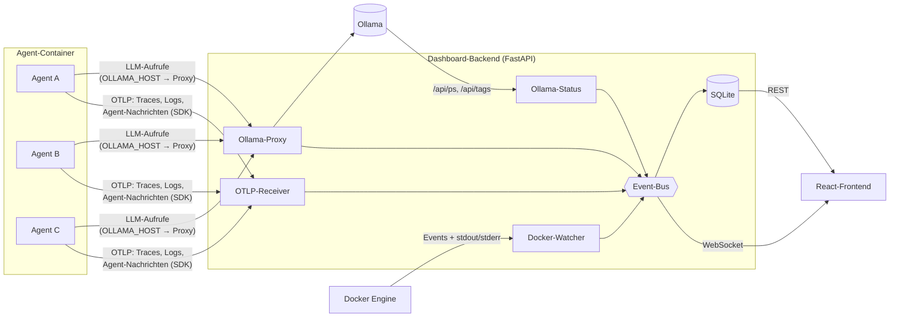
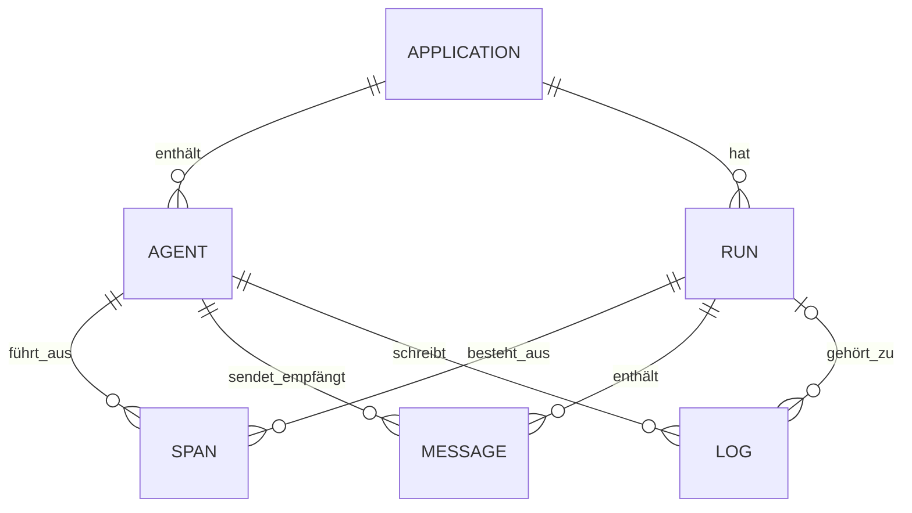

# Agent Dashboard – Projektplan

Status: **Entwurf zur Abstimmung** · Stand: 2026-11-05

## 1. Ziel

Ein selbst gehostetes Dashboard für den Homeserver, das

1. **alle Agenten** zeigt, die laufen oder gelaufen sind (Status, Modell, Container, Aktivität),
2. **die Logs** jedes Agenten live und historisch durchsuchbar macht,
3. **die Kommunikation zwischen Agenten** sichtbar macht, wenn mehrere Agenten in einer Anwendung zusammenarbeiten: wer schickt wem was, in welcher Reihenfolge, mit welchem Ergebnis.

Ursprüngliche Motivation: **Agentenaktionen nachvollziehen können.** Daraus folgt, dass jede Aktion (LLM-Aufruf, Tool-Aufruf mit Argumenten und Ergebnis, Nachricht an einen anderen Agenten) vollständig und mit ihrem Auslöser gespeichert wird.

### Rahmenbedingungen (abgestimmt)

| Thema | Entscheidung |
|---|---|
| Agenten | Lokale Agenten auf Basis von **Ollama** |
| Betrieb | **Docker-Container** |
| Anbindung | **OpenTelemetry + kleines Python-SDK**, ergänzt um passive Quellen |
| Stack | **FastAPI (Python)** + **React/TypeScript** + **SQLite**, Deployment per **docker-compose** |

### Nicht-Ziele (vorerst)

- Kein Steuern der Agenten (Start/Stop/Prompt ändern). Das Dashboard ist zunächst nur Beobachter. Ein Neustart von Containern kann später kommen.
- Kein Mehrbenutzer-/Rechtesystem. Ein einzelner Zugang reicht.
- Keine Cloud-Anbindung. Alles bleibt lokal.

---

## 2. Datenquellen – woher kommen die Informationen?

Vier Quellen ergänzen sich. Die ersten beiden funktionieren **ohne jede Änderung an den Agenten**.



### 2.1 Docker-Watcher (passiv)
- Liest über die Docker-API alle Container mit dem Label `agentdash.enable=true`.
- Labels liefern die Zuordnung: `agentdash.agent=researcher`, `agentdash.app=newsbot`, optional `agentdash.role=…`.
- Erfasst Container-Status (running/exited/restarting), Start, Exit-Code, Restarts und den **stdout/stderr-Stream** als Logs.
- Docker-Socket wird **nur lesend** eingebunden, idealerweise über einen Socket-Proxy (z. B. `tecnativa/docker-socket-proxy`, nur `CONTAINERS` + `EVENTS` erlaubt).

### 2.2 Ollama-Proxy (passiv)
- Das Dashboard stellt einen Ollama-kompatiblen Endpunkt bereit (z. B. Port `11435`). Die Agenten setzen `OLLAMA_HOST=http://agentdash:11435` statt direkt auf Ollama zu zeigen.
- Der Proxy leitet alles 1:1 weiter (inkl. Streaming) und protokolliert pro Aufruf: Modell, Prompt/Messages, Antwort, Tool-Calls, `prompt_eval_count`, `eval_count`, Dauer, Tokens/s und Fehler.
- **Agent-Zuordnung:** über den Header `X-Agent-Name` (setzt das SDK) oder sonst über die Quell-IP, die per Docker-API auf den Container und dessen Labels aufgelöst wird.
- **Run-Zuordnung:** wenn ein `traceparent`-Header mitkommt (SDK), wird der Aufruf als Span in den laufenden Trace eingehängt.
- **Tool-Aufrufe ohne SDK:** Die Entscheidung des Modells (`tool_calls` mit Argumenten) steht in der Antwort. Das Ergebnis steht als `role: tool`-Nachricht im nächsten Request desselben Gesprächs. Der Proxy kann beides verknüpfen und erkennt Folge-Requests am gemeinsamen Nachrichten-Präfix. Bei Reasoning-Modellen wird auch das `thinking`-Feld gespeichert.
- Unterstützt sowohl die native API (`/api/chat`, `/api/generate`) als auch den OpenAI-kompatiblen Endpunkt (`/v1/chat/completions`).

### 2.3 OTLP-Receiver + Python-SDK (aktiv, minimal)
- Backend nimmt **OTLP/HTTP** an (`/v1/traces`, `/v1/logs`, Protobuf und JSON). Damit funktioniert auch jedes andere OTel-fähige Tool.
- Das kleine SDK `agentdash` (Python) kapselt das OTel-SDK und liefert die fehlenden Semantiken für Multi-Agent-Systeme:

```python
from agentdash import init, agent, run, send_message

init(app="newsbot")                         # Endpoint & Service aus ENV

with run("Tagesbericht erstellen"):         # = ein Trace
    with agent("researcher") as researcher: # = Agent-Span
        facts = researcher.llm(...)          # LLM-Call über Proxy, automatisch verknüpft
        send_message(to="writer", content=facts, kind="handoff")
    with agent("writer"):
        ...
```

- `send_message(...)` erzeugt ein Span-Event mit `from`, `to`, `kind` (request/response/handoff/broadcast) und Inhalt. Daraus entsteht später der Kommunikationsgraph.
- Läuft die Kommunikation **über Containergrenzen** (HTTP zwischen Agenten), propagiert das SDK den W3C-`traceparent`-Header, sodass alle Agenten im selben Run landen.
- Python-`logging` wird automatisch mit Agent- und Run-Kontext an das Dashboard weitergeleitet.

### 2.4 Ollama-Status (passiv)
- Pollt `/api/ps` und `/api/tags`: welche Modelle geladen sind, VRAM-Nutzung und verfügbare Modelle.

---

## 3. Datenmodell



| Tabelle | Wichtige Felder |
|---|---|
| `applications` | id, name, beschreibung, first_seen, last_seen |
| `agents` | id, app_id, name, rolle, modell, container_id, status, last_seen |
| `runs` | id (= trace_id), app_id, titel, start, ende, status, token_summe |
| `spans` | id, run_id, parent_id, agent_id, art (`agent`/`llm`/`tool`/`step`), name, start, ende, status, tokens_in, tokens_out, attribute (JSON) |
| `messages` | id, run_id, span_id, from_agent, to_agent, art, inhalt, ts |
| `llm_calls` | id, span_id, agent_id, modell, prompt (JSON), antwort, tokens, dauer_ms, fehler |
| `logs` | id, ts, agent_id, run_id, span_id, level, quelle (`docker`/`sdk`/`proxy`), text, attribute |

- **SQLite im WAL-Modus** mit **FTS5** für die Volltextsuche in Logs und Prompts. Das reicht für einen Homeserver locker.
- **Retention-Job**: z. B. Logs 14 Tage, Runs/Messages 90 Tage, konfigurierbar. Große Prompt-Inhalte optional kürzen.
- Zugriff über eine Repository-Schicht (SQLAlchemy), damit später ein Wechsel auf PostgreSQL ohne Umbau möglich ist.

---

## 4. Frontend – Ansichten

| # | Ansicht | Inhalt |
|---|---|---|
| 1 | **Übersicht** | Agent-Karten nach Anwendung gruppiert, Status-Ampel (aktiv/idle/Fehler/gestoppt), KPI-Leiste (aktive Runs, LLM-Calls/h, Tokens heute, Fehler 24h), Ollama-Kachel (geladene Modelle, VRAM) |
| 2 | **Agent-Detail** | Live-Log-Stream (Pause, Level-Filter, Suche), letzte Runs, LLM-Calls mit aufklappbarem Prompt/Antwort, Latenz- und Token-Verlauf, Container-Infos |
| 3 | **Anwendung / Run** | **Kommunikationsgraph** (React Flow: Knoten = Agenten, Kanten = Nachrichten mit Anzahl, live animiert), **Sequenzdiagramm/Swimlanes** (Zeitachse, Nachrichten als Pfeile), Nachrichten-Inspector, **Replay-Slider** für vergangene Runs |
| 4 | **Trace-Wasserfall** | Span-Baum eines Runs: welcher Agent wann was gemacht hat, wo Zeit verloren ging |
| 5 | **Log-Explorer** | Globale Suche über alle Agenten, Filter nach App/Agent/Level/Zeitraum/Quelle, Sprung in den zugehörigen Run |
| 6 | **Einstellungen** | Retention, Agent-Registry (Anzeigenamen, Farben), Zugangsdaten |

- **Live-Updates** über eine WebSocket-Verbindung mit Topic-Abos (`agent:<id>`, `run:<id>`, `overview`). So lädt nur das, was gerade sichtbar ist.
- UI-Bausteine: Vite, React, TypeScript, TanStack Query, React Flow, Tailwind und eine Chart-Bibliothek (z. B. Recharts). Dark Mode von Anfang an.

---

## 5. Architektur & Repo-Struktur

```
agent_dashboard/
├── backend/                 # FastAPI
│   ├── app/
│   │   ├── api/             # REST-Endpunkte + WebSocket
│   │   ├── ingest/
│   │   │   ├── otlp.py          # OTLP/HTTP-Receiver
│   │   │   ├── ollama_proxy.py  # Ollama-Proxy inkl. Streaming
│   │   │   ├── docker_watcher.py
│   │   │   └── ollama_status.py
│   │   ├── core/            # Event-Bus, Config, Retention
│   │   ├── db/              # Modelle, Migrationen (Alembic)
│   │   └── main.py
│   └── tests/
├── frontend/                # Vite + React + TS
├── sdk/python/agentdash/    # Python-SDK (pip-installierbar)
├── examples/
│   └── multi_agent_demo/    # Demo: 3 Agenten über Ollama, zum Testen
├── deploy/
│   └── docker-compose.yml   # dashboard, docker-socket-proxy, (ollama)
└── docs/
```

- **Ein Backend-Container** bedient REST, WebSocket, OTLP, den Ollama-Proxy und liefert das gebaute Frontend aus. Für einen Homeserver ist das einfacher als mehrere Dienste.
- Intern entkoppelt ein **asyncio-Event-Bus** Ingestion, Persistenz und Live-Push. Schreiben erfolgt gebündelt (Batch-Inserts), damit viele Log-Zeilen die DB nicht ausbremsen.

---

## 6. Sicherheit & Betrieb

- Standardmäßig **nur im LAN** erreichbar. Für Zugriff von außen hinter einen Reverse Proxy (Caddy/Traefik) mit HTTPS.
- Login per einfachem Passwort/Token (gesetzt per ENV), Session-Cookie. OTLP- und Proxy-Endpunkte optional mit API-Key.
- Prompts werden standardmäßig **vollständig** gespeichert, damit Aktionen nachvollziehbar bleiben. Weil sie sensible Inhalte enthalten können, gibt es eine Option zum Kürzen oder Weglassen, plus Retention.
- Docker-Socket nur über einen Socket-Proxy mit Leserechten.
- Healthcheck-Endpunkt; das Dashboard soll weiterlaufen, auch wenn Ollama oder Docker kurz weg sind. Der Proxy darf Agenten **niemals blockieren**: Fällt die Protokollierung aus, wird trotzdem weitergeleitet.

---

## 7. Umsetzung in Meilensteinen

Jeder Meilenstein ist für sich nutzbar.

| MS | Inhalt | Ergebnis |
|---|---|---|
| **M0** | Gerüst: Repo-Struktur, FastAPI + React, SQLite-Schema + Alembic, docker-compose, Lint/Tests | Leeres Dashboard läuft per `docker compose up` |
| **M1** | Docker-Watcher, Übersicht, Agent-Detail mit Live-Container-Logs | Alle Agent-Container sichtbar, **ohne Codeänderung** |
| **M2** | Ollama-Proxy + Ollama-Status, LLM-Calls im Agent-Detail | Jeder LLM-Aufruf mit Prompt, Tokens, Latenz sichtbar |
| **M3** | OTLP-Receiver + Python-SDK + Demo-Anwendung, Runs + Trace-Wasserfall | Runs mit Span-Baum, Logs mit Run-Kontext |
| **M4** | Kommunikationsgraph, Sequenzdiagramm, Replay | Multi-Agent-Kommunikation live und rückblickend |
| **M5** | Log-Explorer (FTS), Retention, Auth, Feinschliff, Doku | Alltagstauglich auf dem Homeserver |

**Demo-Anwendung** (ab M3): eine kleine Multi-Agent-App mit z. B. `planner → researcher → writer → critic` auf einem kleinen Ollama-Modell (z. B. `llama3.2:3b` oder `qwen2.5:3b`). Sie dient als Testfall und als Vorlage für eigene Agenten.

### Teststrategie
- Backend: pytest für Parser (OTLP, Ollama-Streaming), Repository-Schicht, API. Ollama wird in Tests gemockt.
- SDK: Unit-Tests gegen einen In-Memory-Exporter.
- Frontend: Komponententests für Graph-/Timeline-Aufbereitung (Vitest).
- End-to-End: Demo-App gegen das laufende Dashboard (docker-compose), Playwright-Smoke-Test.

---

## 8. Alternativen (bewusst abgewogen)

- **Langfuse / Arize Phoenix** (self-hosted): sehr gutes LLM-Tracing, aber kein Docker-/Container-Bezug, keine Agent-Inventar-Übersicht und kein echter Kommunikationsgraph zwischen Agenten. Weil das Dashboard OTLP spricht, bleibt es kompatibel: Daten lassen sich bei Bedarf parallel dorthin exportieren.
- **Grafana + Loki + Tempo**: mächtig, aber schwergewichtig für einen Homeserver und ohne agentenspezifische Ansichten.

---

## 9. Offene Fragen

1. **Wie kommunizieren deine Agenten heute untereinander?** Im selben Python-Prozess (ein Container, mehrere Agenten), per HTTP zwischen Containern oder über eine Queue (z. B. Redis)? Das bestimmt, wie das SDK die Kommunikation abgreift.
2. **Läuft Ollama selbst im Docker** oder nativ auf dem Host? Gibt es eine GPU (für die VRAM-Anzeige)?
3. **Gibt es schon Agenten-Code**, an dem wir das SDK direkt ausprobieren können?
4. **Zugriff**: nur im LAN oder auch von unterwegs (z. B. via Tailscale/Reverse Proxy)?
5. **Aufbewahrung**: Wie lange sollen Logs und Prompts gespeichert werden?
6. **Hardware des Homeservers** (CPU-Architektur x86/ARM, RAM): relevant für die Docker-Images.
